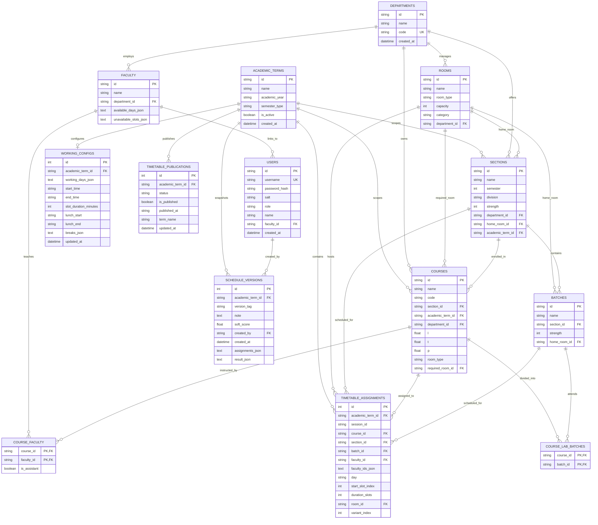

# AutoSchedule — Relational Database Management System Design

## 1. Executive Summary

AutoSchedule has transitioned from an unstructured JSON document model to a normalized, high-performance relational database management system (DBMS) powered by **SQLAlchemy ORM**, **SQLite** (default local and demonstration database), and **Alembic/Flask-Migrate** for schema migrations.

The database architecture is designed with strict referential integrity, foreign key cascading rules, unique domain constraints, composite indexes for time-slot lookups, and clear normalization principles. The persistence layer is completely decoupled from the constraint-satisfaction scheduling engine, ensuring high performance in-memory solving with reliable, transactional persistence in SQLite or PostgreSQL.

---

## 2. Entity-Relationship Diagram (Mermaid)

---

## 3. Relational Schema Specification

### 3.1 `academic_terms`
Stores distinct academic calendar terms (e.g., Odd Semester 2026-27).
- `id` (VARCHAR(64), Primary Key)
- `name` (VARCHAR(128), Not Null)
- `academic_year` (VARCHAR(32), Not Null)
- `semester_type` (VARCHAR(16), Default 'ODD', Not Null)
- `is_active` (BOOLEAN, Default FALSE, Indexed)
- `created_at` (DATETIME, Not Null)

### 3.2 `departments`
Stores academic departments that administer faculty, classrooms, and courses.
- `id` (VARCHAR(64), Primary Key)
- `name` (VARCHAR(128), Not Null)
- `code` (VARCHAR(32), Unique, Not Null, Indexed)
- `created_at` (DATETIME, Not Null)

### 3.3 `users`
Stores user identities, credentials, and role-based access levels.
- `id` (VARCHAR(64), Primary Key)
- `username` (VARCHAR(64), Unique, Not Null, Indexed)
- `password_hash` (VARCHAR(128), Not Null)
- `salt` (VARCHAR(64), Not Null)
- `role` (VARCHAR(32), Not Null, Indexed) — 'ADMIN', 'COORDINATOR', 'FACULTY', 'STUDENT'
- `name` (VARCHAR(128), Not Null)
- `faculty_id` (VARCHAR(64), Foreign Key -> `faculty.id`, ON DELETE SET NULL, Nullable)
- `created_at` (DATETIME, Not Null)

### 3.4 `working_configs`
Stores timetable configuration parameters per academic term.
- `id` (INTEGER, Primary Key, Autoincrement)
- `academic_term_id` (VARCHAR(64), Foreign Key -> `academic_terms.id`, ON DELETE CASCADE, Indexed)
- `working_days_json` (TEXT, Not Null)
- `start_time` (VARCHAR(16), Not Null, Default '09:00')
- `end_time` (VARCHAR(16), Not Null, Default '17:00')
- `slot_duration_minutes` (INTEGER, Not Null, Default 60)
- `lunch_start` (VARCHAR(16), Not Null, Default '13:00')
- `lunch_end` (VARCHAR(16), Not Null, Default '14:00')
- `breaks_json` (TEXT, Not Null, Default '[]')
- `updated_at` (DATETIME)

### 3.5 `rooms`
Physical and virtual learning spaces.
- `id` (VARCHAR(64), Primary Key)
- `name` (VARCHAR(128), Not Null)
- `room_type` (VARCHAR(32), Not Null, Indexed) — 'THEORY_ROOM', 'LAB'
- `capacity` (INTEGER, Nullable)
- `category` (VARCHAR(64), Nullable)
- `department_id` (VARCHAR(64), Foreign Key -> `departments.id`, ON DELETE SET NULL, Indexed)

### 3.6 `faculty`
Academic instructors with availability rules.
- `id` (VARCHAR(64), Primary Key)
- `name` (VARCHAR(128), Not Null)
- `department_id` (VARCHAR(64), Foreign Key -> `departments.id`, ON DELETE SET NULL, Indexed)
- `available_days_json` (TEXT, Nullable) — List of working days the faculty is available
- `unavailable_slots_json` (TEXT, Nullable) — List of specific {day, slot_index} blackouts

### 3.7 `sections`
Student cohorts within a specific semester.
- `id` (VARCHAR(64), Primary Key)
- `name` (VARCHAR(128), Not Null)
- `semester` (INTEGER, Not Null, Indexed)
- `division` (VARCHAR(16), Not Null)
- `strength` (INTEGER, Nullable)
- `department_id` (VARCHAR(64), Foreign Key -> `departments.id`, ON DELETE SET NULL, Indexed)
- `home_room_id` (VARCHAR(64), Foreign Key -> `rooms.id`, ON DELETE SET NULL)
- `academic_term_id` (VARCHAR(64), Foreign Key -> `academic_terms.id`, ON DELETE CASCADE, Indexed)

### 3.8 `batches`
Subdivisions of student cohorts for laboratory sessions.
- `id` (VARCHAR(64), Primary Key)
- `name` (VARCHAR(128), Not Null)
- `section_id` (VARCHAR(64), Foreign Key -> `sections.id`, ON DELETE CASCADE, Not Null, Indexed)
- `strength` (INTEGER, Nullable)
- `home_room_id` (VARCHAR(64), Foreign Key -> `rooms.id`, ON DELETE SET NULL)

### 3.9 `courses`
Academic subjects with L-T-P lecture-tutorial-practical structures.
- `id` (VARCHAR(64), Primary Key)
- `name` (VARCHAR(128), Not Null)
- `code` (VARCHAR(32), Not Null, Indexed)
- `section_id` (VARCHAR(64), Foreign Key -> `sections.id`, ON DELETE CASCADE, Not Null, Indexed)
- `academic_term_id` (VARCHAR(64), Foreign Key -> `academic_terms.id`, ON DELETE CASCADE, Indexed)
- `department_id` (VARCHAR(64), Foreign Key -> `departments.id`, ON DELETE SET NULL, Indexed)
- `l` (FLOAT, Not Null, Default 3.0)
- `t` (FLOAT, Not Null, Default 0.0)
- `p` (FLOAT, Not Null, Default 0.0)
- `room_type` (VARCHAR(32), Not Null, Default 'THEORY_ROOM')
- `required_room_id` (VARCHAR(64), Foreign Key -> `rooms.id`, ON DELETE SET NULL)

### 3.10 `course_faculty` (Association Table)
Many-to-many relationship supporting lead and assistant instructors per course.
- `course_id` (VARCHAR(64), Foreign Key -> `courses.id`, ON DELETE CASCADE, Primary Key)
- `faculty_id` (VARCHAR(64), Foreign Key -> `faculty.id`, ON DELETE CASCADE, Primary Key, Indexed)
- `is_assistant` (BOOLEAN, Not Null, Default FALSE)

### 3.11 `course_lab_batches` (Association Table)
Many-to-many relationship linking lab courses to specific section batches.
- `course_id` (VARCHAR(64), Foreign Key -> `courses.id`, ON DELETE CASCADE, Primary Key)
- `batch_id` (VARCHAR(64), Foreign Key -> `batches.id`, ON DELETE CASCADE, Primary Key, Indexed)

### 3.12 `timetable_publications`
Lifecycle status of schedule publications per academic term.
- `id` (INTEGER, Primary Key, Autoincrement)
- `academic_term_id` (VARCHAR(64), Foreign Key -> `academic_terms.id`, ON DELETE CASCADE, Indexed)
- `status` (VARCHAR(32), Not Null, Default 'DRAFT') — 'DRAFT', 'PUBLISHED', 'ARCHIVED'
- `is_published` (BOOLEAN, Not Null, Default FALSE, Indexed)
- `published_at` (VARCHAR(64), Nullable)
- `term_name` (VARCHAR(128), Nullable)
- `updated_at` (DATETIME)

### 3.13 `timetable_assignments`
The normalized operational schedule containing individual session allocations.
- `id` (INTEGER, Primary Key, Autoincrement)
- `academic_term_id` (VARCHAR(64), Foreign Key -> `academic_terms.id`, ON DELETE CASCADE, Indexed)
- `session_id` (VARCHAR(128), Not Null, Indexed)
- `course_id` (VARCHAR(64), Foreign Key -> `courses.id`, ON DELETE SET NULL, Indexed)
- `section_id` (VARCHAR(64), Foreign Key -> `sections.id`, ON DELETE SET NULL, Indexed)
- `batch_id` (VARCHAR(64), Foreign Key -> `batches.id`, ON DELETE SET NULL, Indexed)
- `faculty_id` (VARCHAR(64), Foreign Key -> `faculty.id`, ON DELETE SET NULL, Indexed)
- `faculty_ids_json` (TEXT, Nullable)
- `day` (VARCHAR(32), Not Null, Indexed)
- `start_slot_index` (INTEGER, Not Null, Indexed)
- `duration_slots` (INTEGER, Not Null, Default 1)
- `room_id` (VARCHAR(64), Foreign Key -> `rooms.id`, ON DELETE CASCADE, Not Null, Indexed)
- `variant_index` (INTEGER, Not Null, Default 0, Indexed)

**Composite Performance Indexes:**
- `idx_assign_term_day_slot_room`: `(academic_term_id, day, start_slot_index, room_id)`
- `idx_assign_term_section_day_slot`: `(academic_term_id, section_id, day, start_slot_index)`

### 3.14 `schedule_versions`
Audit snapshots of generated schedules with quality scores.
- `id` (INTEGER, Primary Key, Autoincrement)
- `academic_term_id` (VARCHAR(64), Foreign Key -> `academic_terms.id`, ON DELETE CASCADE, Indexed)
- `version_tag` (VARCHAR(64), Not Null)
- `note` (TEXT, Nullable)
- `soft_score` (FLOAT, Nullable)
- `created_by` (VARCHAR(64), Foreign Key -> `users.id`, ON DELETE SET NULL)
- `created_at` (DATETIME, Not Null)
- `assignments_json` (TEXT, Not Null)
- `result_json` (TEXT, Nullable)

---

## 4. Normalization Analysis

### First Normal Form (1NF)
- Every table has a distinct primary key (`id` or composite primary key for association tables).
- Repeating groups have been removed. Multi-instructor courses and multi-batch labs are decomposed into distinct rows in `course_faculty` and `course_lab_batches`.
- Each column contains values of a single well-defined type.

### Second Normal Form (2NF)
- All non-key attributes are fully functionally dependent on the entire primary key.
- In composite-key tables (`course_faculty`, `course_lab_batches`), attributes like `is_assistant` depend on the composite pair `(course_id, faculty_id)`.

### Third Normal Form (3NF) & Boyce-Codd Normal Form (BCNF)
- Transitive dependencies have been eliminated:
  - Department codes and names are isolated in `departments` rather than duplicated in `rooms`, `faculty`, and `courses`.
  - Room properties (capacity, category, room type) are isolated in `rooms` rather than duplicated in assignments.
  - Section divisions, semesters, and home rooms are isolated in `sections`.
- Cascading deletes (`ON DELETE CASCADE`) are placed on parent-child compositions (e.g. `Section -> Batch`, `Course -> CourseFaculty`), while references to independent resources use `ON DELETE SET NULL` (e.g. `Course -> required_room_id`).

### Pragmatic Denormalization & Structured JSON Fields
For high-speed CSP matrix initialization and weekly schedule rendering, certain non-relational calendar structures are stored as structured JSON columns:
1. `working_days_json` and `breaks_json`: Calendar days and break periods are configured per term as simple ordered arrays without requiring a separate break-period junction table.
2. `available_days_json` and `unavailable_slots_json`: Faculty availability masks are loaded into solver memory in a single read query.
3. `assignments_json` in `schedule_versions`: Version snapshots preserve exact frozen representations of historical schedules for fast rollback without disturbing active operational tables.

