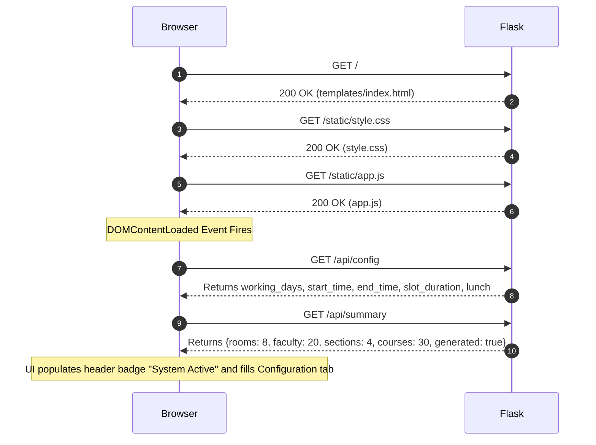
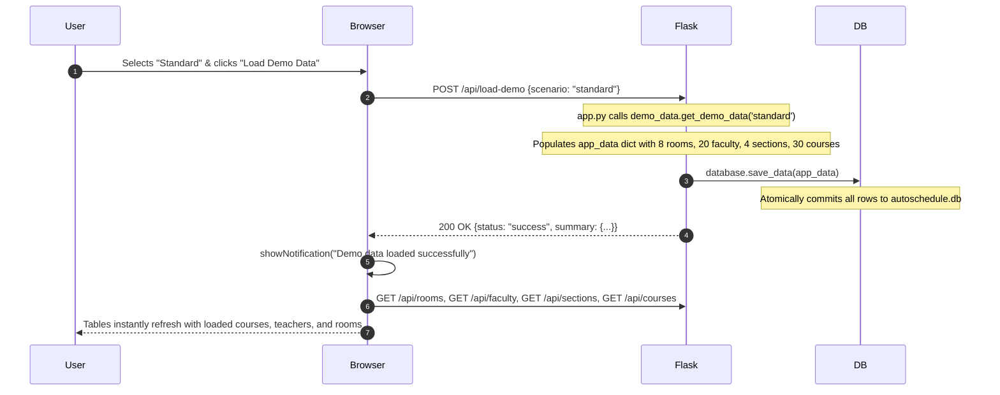
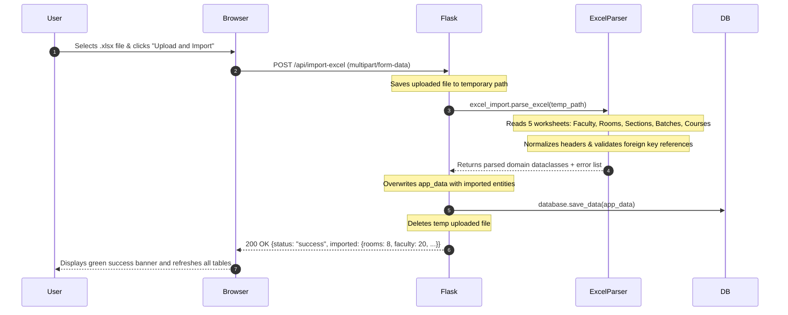
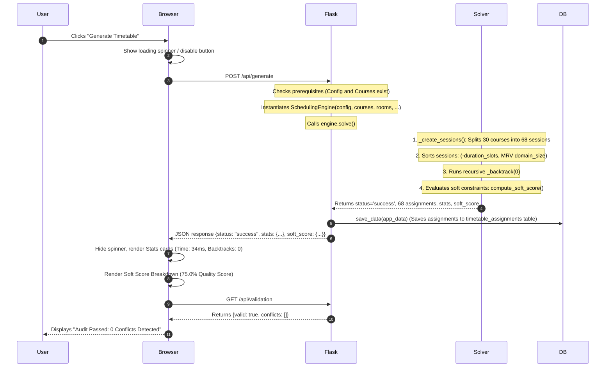

# Complete Application Workflow — CampusGrid
## End-to-End Execution Traces from Browser Click to Database

---

### Step 1: User Opens the Application in the Browser

```
User navigates to http://127.0.0.1:5001
```



1. Browser requests `http://127.0.0.1:5001`.
2. Flask route `@app.route('/')` serves `index.html`.
3. The browser parses HTML and pulls `static/style.css` and `static/app.js`.
4. Inside `app.js`, initialization functions trigger:
   - `loadConfig()`: Calls `GET /api/config` to populate working hours forms.
   - `fetchSummary()`: Calls `GET /api/summary` to refresh dashboard counts.
   - Sets the active tab to `Configuration`.

---

### Step 2: User Loads Demo Data

```
User selects "Standard Scenario" dropdown and clicks "Load Demo Data"
```



1. Browser fires `fetchJSON('/api/load-demo', {method: 'POST', body: JSON.stringify({scenario: 'standard'})})`.
2. `app.py` invokes `get_demo_data('standard')` from `demo_data.py`.
3. `get_demo_data()` returns pure Python dataclasses for 8 classrooms/labs, 20 faculty, 4 sections, and 30 courses.
4. `database.save_data(app_data)` updates `autoschedule.db` atomically inside a thread lock.
5. Flask responds with `200 OK`. The client UI displays a green success toast and refreshes all table views.

---

### Step 3: User Adds or Edits Academic Information

```
User clicks "Courses" tab -> Fills form (L=3, T=0, P=2, selects Dr. Sharma, selects Lab 1) -> Clicks "Save Course"
```

1. Browser gathers form inputs and submits `POST /api/courses`.
2. `app.py` validates required fields (`code`, `name`, `section_id`, `l`, `t`, `p`).
3. Instantiates `Course` dataclass and appends it to `app_data['courses']`.
4. Calls `save_data(app_data)` to write changes immediately to SQLite.
5. Returns `201 Created` with the newly assigned course id.
6. `app.js` updates the Courses table and updates the dependency dropdowns in real time.

---

### Step 4: User Imports Timetable Data via Excel

```
User downloads template -> Enters data in Excel -> Uploads timetable.xlsx
```



1. Browser sends `.xlsx` file via `FormData` to `/api/import-excel`.
2. `excel_import.py` opens workbook using OpenPyXL (`data_only=True`).
3. Validates that all 5 sheets exist and verifies references (e.g., that courses reference valid faculty IDs and section IDs).
4. Returns parsed `Room`, `Faculty`, `Section`, `Batch`, and `Course` lists.
5. `save_data(app_data)` persists the imported college structure to `autoschedule.db`.

---

### Step 5: User Clicks "Generate Timetable"

```
User opens "Generate" tab and clicks the blue "Generate Timetable" button
```



1. Browser displays a loading spinner and calls `POST /api/generate`.
2. `SchedulingEngine` decomposes all courses into discrete `ScheduleSession` units based on L-T-P.
3. Sessions are sorted so the hardest items (multi-hour labs and sessions with fewest free slots) are placed first.
4. `_backtrack(0)` finds a mathematically proven conflict-free placement across all working days and rooms.
5. `compute_soft_score()` calculates the 7 quality metrics (0–100%).
6. `save_data()` writes the resulting timetable assignments to `autoschedule.db`.
7. `app.js` updates the KPI cards (execution time, backtracks, total sessions, soft score).
8. Immediately calls `/api/validation` to run an independent audit and verify 0 conflicts!

---

### Step 6: User Views the Timetable Across Different Dimensions

```
User navigates to "Timetable Views" tab
```

The application provides **4 distinct perspectives** on the same underlying schedule:

#### 1. Master View (`/api/timetable/master`)
- Displays all scheduled sessions across the entire department in a flat, sortable table.
- Columns: Day, Time, Section, Course Name, Type, Faculty, Room.

#### 2. By Section View (`/api/timetable/section/<section_id>`)
- User selects Section (e.g. `Section 3A`).
- The server constructs a 2D grid:
  - **Rows (Y-axis)**: Working Days (Monday through Friday).
  - **Columns (X-axis)**: Daily Time Slots (09:00–10:00, 10:00–11:00, etc.).
  - **Lunch break**: Rendered as a distinct vertical gray column.
  - Each cell shows the course code, subject name, teacher name, and assigned room.

#### 3. By Faculty View (`/api/timetable/faculty/<faculty_id>`)
- User selects a teacher (e.g. `Dr. Sharma`).
- Generates that teacher's personalized weekly schedule. Allows teachers to see their exact daily lecture hours, free periods, and lab sessions at a glance.

#### 4. By Room View (`/api/timetable/room/<room_id>`)
- User selects a classroom or lab (e.g. `Computer Lab 1`).
- Generates the room's weekly occupancy matrix. Essential for lab technicians and estate managers to check room availability.

#### 5. Print Timetable
- User clicks the **"Print Timetable"** button.
- CSS print media queries (`@media print`) strip away navigation bars, buttons, and forms, producing a clean, high-resolution timetable document suitable for printing or saving as PDF!
