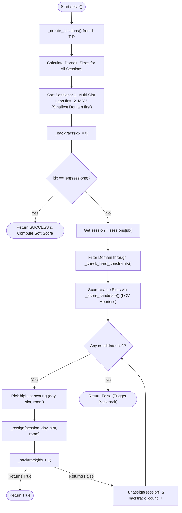

# The Scheduling Algorithm — CampusGrid
## Mathematical Foundations, CSP, Backtracking, and Heuristics

---

### 1. What is a Constraint Satisfaction Problem (CSP)?

In Artificial Intelligence, a **Constraint Satisfaction Problem (CSP)** consists of three mathematical components:

$$\text{CSP} = \langle X, D, C \rangle$$

1. **Variables ($X$)**: The items that need to be decided or scheduled.
   In our system, each variable is a **`ScheduleSession`** (e.g. `CS301_T0`, `CS302_L0`).
2. **Domains ($D$)**: The set of possible values that can be assigned to a variable.
   In our system, a value is a triplet: **`(day, start_slot_index, room_id)`**.
   For example, `("Monday", 0, "R101")`.
3. **Constraints ($C$)**: The rules that restrict which combinations of values can be assigned simultaneously.

---

### 2. Hard Constraints vs. Soft Constraints

Our system clearly separates constraints into two fundamental categories:

#### A. Hard Constraints (Must NEVER be violated)
A schedule is **invalid** if even a single hard constraint is broken. In `scheduler.py`, these are enforced in `_check_hard_constraints()` and `validate_timetable()`:

1. **Faculty Clash Constraint**: A teacher cannot teach two different classes at the same day and time.
   $$\forall s_1, s_2, \quad \text{faculty}(s_1) \cap \text{faculty}(s_2) \neq \emptyset \implies \text{slot}(s_1) \cap \text{slot}(s_2) = \emptyset$$
2. **Room Clash Constraint**: A physical room cannot hold two classes at the same time.
   $$\forall s_1, s_2, \quad \text{room}(s_1) = \text{room}(s_2) \implies \text{slot}(s_1) \cap \text{slot}(s_2) = \emptyset$$
3. **Section Clash Constraint**: A classroom section (e.g., Section 3A) cannot have two subjects scheduled at the same time.
4. **Batch Clash Constraint**: If Section 3A is attending a whole-class lecture, no sub-batch (A1, A2) can have a lab at the same time; conversely, two different batches (A1 and A2) can run labs simultaneously in different labs.
5. **Room Suitability**: A Computer Lab course can only be assigned to a room where `room_type == 'LAB'`.
6. **Consecutive Slot Integrity**: Multi-hour labs (e.g. 2 hours) must occupy consecutive slots on the same day and **cannot cross lunch breaks or day boundaries** (`check_consecutive_slots`).
7. **Seating Capacity**: The room capacity must be $\ge$ section/batch student strength.

#### B. Soft Constraints (Optimization / Comfort)
Soft constraints do not invalidate the timetable, but determine its **quality** (scored 0 to 100%). In `scheduler.py`, these are calculated by `compute_soft_score()` and guided by `_score_candidate()`:

| Criterion | Max Score | Goal / Rule |
| :--- | :---: | :--- |
| **Subject Distribution** | 20 pts | Distribute lectures of a course evenly across the 5 days instead of clumping them. |
| **No Same Subject Same Day** | 15 pts | Avoid giving students two lectures of the same course on the same day. |
| **Minimize Student Idle Gaps** | 15 pts | Avoid 1–2 hour empty gaps in student schedules between morning and afternoon classes. |
| **Faculty Workload Target** | 15 pts | Keep weekly faculty teaching hours close to departmental target (~20 hours). |
| **Faculty Daily Balance** | 10 pts | Balance daily hours so a teacher doesn't have 6 hours on Tuesday and 0 on Thursday. |
| **Consecutive Faculty Limit** | 15 pts | Prevent teachers from having more than 3 continuous hours without a rest period. |
| **Room Utilization Balance** | 10 pts | Avoid over-using one classroom while others sit completely empty. |
| **Total Quality Score** | **100 pts** | Comprehensive percentage score displayed on the UI. |

---

### 3. The Search Algorithm: Intelligent Backtracking with MRV

If we used simple brute-force search, the computer would freeze trying trillions of combinations. Our system uses three powerful AI optimization techniques:



#### Technique 1: Minimum Remaining Values (MRV) Heuristic
- **Concept**: "Fail-First Principle". If you have 10 assignments to make, and one assignment has only 2 valid slots left while another has 30, **schedule the one with 2 slots first**!
- Why? If that tight assignment is going to fail, it is much better to fail right now at depth 2 of the tree than to discover the failure at depth 69 after wasting 10 minutes of computing time.
- In `scheduler.py`:
  ```python
  domain_sizes = {s.id: len(self._get_domain(s)) for s in self.sessions}
  # Multi-slot labs first (-s.duration_slots), then smallest domain (MRV)
  self.sessions.sort(key=lambda s: (-s.duration_slots, domain_sizes[s.id]))
  ```

#### Technique 2: Least Constraining / Best Value Ordering
When picking which time slot to assign to a session, we sort the viable candidates by `_score_candidate()`:
```python
viable.sort(key=lambda x: -x[0])  # Try highest quality slot first!
```
This ensures the solver tries slots that preserve schedule balance and minimize student gaps before exploring worse options.

#### Technique 3: Forward Checking & Domain Filtering
Before even entering the recursive loop, `_get_domain()` filters out impossible candidates:
- If a session is a 2-hour lab, slots that collide with lunch or extend beyond the end of the day are discarded immediately.
- If a session is a theory lecture, lab rooms are excluded immediately.

---

### 4. Real-Life Step-by-Step Example

Let's walk through a concrete example with:
- **Faculty**: Dr. Sharma (DS), Prof. Patel (DBMS), Dr. Gupta (OS)
- **Rooms**: Room 101 (`THEORY_ROOM`), Computer Lab 1 (`LAB`)
- **Sections**: Section 3A (30 students), Section 3B (30 students)
- **Time Slots**: 
  - Slot 0: 09:00 – 10:00 AM
  - Slot 1: 10:00 – 11:00 AM
  - Slot 2: 11:00 – 12:00 PM
  - Lunch: 12:00 – 01:00 PM
  - Slot 3: 01:00 – 02:00 PM

#### Courses to Schedule:
1. `CS_DS_Lab`: Section 3A, Practical (2 hours), Dr. Sharma, Computer Lab 1
2. `CS_DS_Th`: Section 3A, Theory (1 hour), Dr. Sharma, Room 101
3. `CS_DBMS_Th`: Section 3B, Theory (1 hour), Prof. Patel, Room 101
4. `CS_OS_Th`: Section 3A, Theory (1 hour), Dr. Gupta, Room 101

#### Step-by-Step Decision Trace:

| Step | Action | Solver Decision & Reasoning |
| :---: | :--- | :--- |
| **1** | **Session Ordering** | `CS_DS_Lab` has duration 2 slots and requires `Computer Lab 1`. Its domain is very small (only valid 2-hour blocks: Slots 0-1, or 1-2). By **MRV & Duration Priority**, it is placed **first**! |
| **2** | **Assign Session 1** | Assign `CS_DS_Lab` $\rightarrow$ **Monday, Slots 0–1 (09:00–11:00), Computer Lab 1**. Faculty: Dr. Sharma; Section: 3A. |
| **3** | **Next Session** | Next is `CS_DS_Th` (Dr. Sharma, Section 3A). Domain check: Can it go on Monday at Slot 0 or 1? **NO** (Dr. Sharma and Section 3A are busy in Lab 1). Can it go in Slot 2 (11:00–12:00)? Yes! Room 101 is free. |
| **4** | **Candidate Scoring** | `_score_candidate()` checks: Is Dr. Sharma teaching DS twice on Monday? Yes, Lab + Theory. But is Tuesday available? Yes! Tuesday Slot 0 has a higher score (penalty avoided). Assign `CS_DS_Th` $\rightarrow$ **Tuesday, Slot 0, Room 101**. |
| **5** | **Next Session** | Assign `CS_DBMS_Th` (Prof. Patel, Section 3B). Domain check: Monday Slot 0 is open in Room 101! (Room 101 is free, Prof. Patel is free, Section 3B is free). Assign $\rightarrow$ **Monday, Slot 0, Room 101**. |
| **6** | **Next Session** | Assign `CS_OS_Th` (Dr. Gupta, Section 3A). Domain check: Monday Slot 0? Section 3A is in Lab! Monday Slot 2? Section 3A is free, Room 101 is free, Dr. Gupta is free. Assign $\rightarrow$ **Monday, Slot 2, Room 101**. |
| **Result** | **Success** | All sessions placed with 0 conflicts, 0 backtracks, and maximum quality score! |

---

### 5. What Happens When No Valid Slot Is Available? (Backtracking & Diagnostics)

Suppose an impossible scenario is requested (e.g. 50 lab hours requested, but only 35 lab hours exist in the week):
1. **Backtrack Limit**: The solver tries alternatives. If all options fail, it unassigns the previous variable and tries a different slot.
2. **Safety Cutoffs**: To prevent infinite hanging, our engine has safety guards:
   - `MAX_BACKTRACKS = 50,000`
   - `MAX_TIME_SECONDS = 30.0`
3. **Automated Diagnostics**: When infeasible, `_diagnose()` executes and returns exact demand vs. capacity analysis:
   ```
   Capacity shortfall: Lab demand (32 slots) exceeds available (35 slots).
   Theory demand: 52 slots (Available: 70)
   ```
   This gives the Academic Administrator actionable feedback on exactly what resource is lacking (e.g. "Add 1 more computer lab" or "Increase working hours").

---

### 6. Implemented Features vs. Theoretical Concepts

To ensure full honesty during the technical evaluation:

| Concept | Implemented in Our Code? | How It Works in Our Code |
| :--- | :---: | :--- |
| **Constraint Satisfaction Problem (CSP)** | **YES** | Variables = `ScheduleSession`, Domains = `(day, slot, room)`, Constraints = hard checks. |
| **Backtracking Search** | **YES** | Recursive `_backtrack(idx)` with `_assign()` and `_unassign()`. |
| **Minimum Remaining Values (MRV)** | **YES** | Sessions sorted by `(-duration_slots, domain_size)`. |
| **Least Constraining Value (LCV)** | **YES** | Viable candidates sorted by `_score_candidate()`. |
| **Forward Checking / Pruning** | **YES** | Illegal consecutive slots and incompatible rooms eliminated in `_get_domain()`. |
| **AC-3 (Arc Consistency 3)** | **NO** | Theoretical full arc consistency is omitted because MRV + Backtracking solves typical college timetables in <100ms without the polynomial overhead of AC-3. |
| **Genetic Algorithms / Simulated Annealing** | **NO** | Not used. CSP Backtracking provides a guaranteed conflict-free exact solution; stochastic algorithms only provide approximations. |
