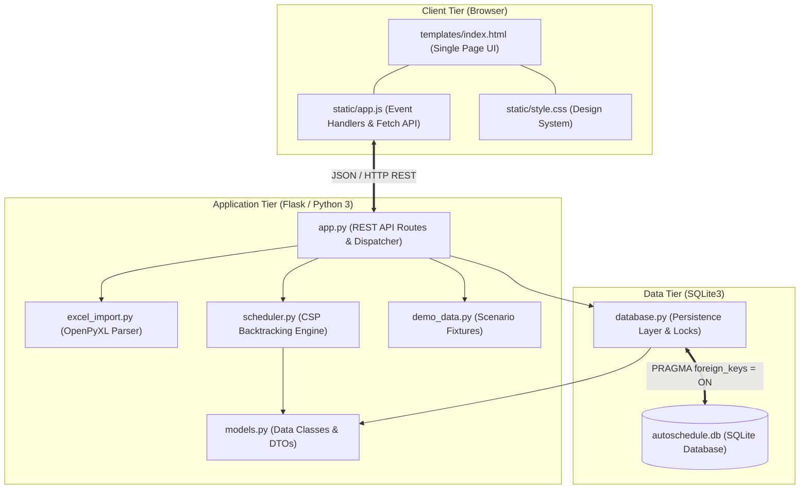
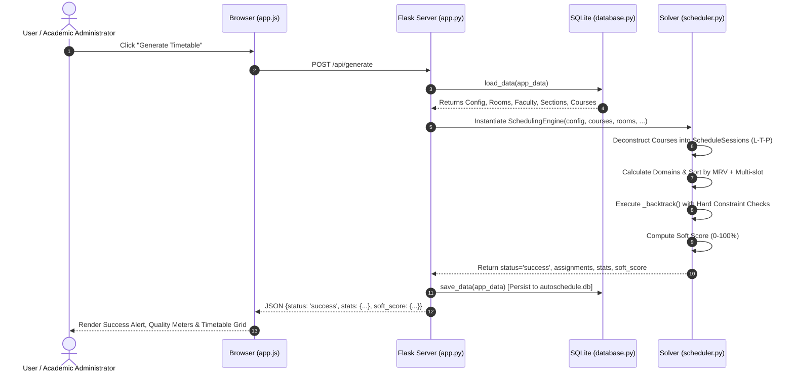

# System Architecture — CampusGrid
## Technical Design, Module Structure, and Data Flow

---

### 1. High-Level Architecture Overview

CampusGrid is engineered as a **modular three-tier web application**:
1. **Client Tier (Frontend)**: Responsive Single-Page Application (SPA) built with semantic HTML5, CSS3, and vanilla modern JavaScript (Fetch API, DOM manipulation).
2. **Application Tier (Backend)**: Flask REST API micro-framework running Python 3.10+, handling routing, business logic, validation, Excel parsing, and CSP scheduling algorithms.
3. **Data Tier (Persistence)**: Embedded SQLite database (`autoschedule.db`) with Foreign Key enforcement and thread-safe read/write transactions.

---

### 2. Python Modules and Their Responsibilities

| Module | Primary Responsibility | Key Functions / Classes | Communicates With |
| :--- | :--- | :--- | :--- |
| **`app.py`** | Central web application entry point; exposes 24 REST endpoints; handles HTTP requests/responses. | `index()`, `generate_timetable()`, `load_demo()`, `import_excel()`, `download_template()`, view endpoints | `database.py`, `scheduler.py`, `demo_data.py`, `excel_import.py` |
| **`scheduler.py`** | Core mathematical solver; implements CSP variables, domains, hard/soft constraints, backtracking, and quality scoring. | `SchedulingEngine`, `solve()`, `_backtrack()`, `_check_hard_constraints()`, `_score_candidate()`, `validate_timetable()`, `compute_soft_score()` | `models.py`, called by `app.py` |
| **`database.py`** | SQLite abstraction layer; handles schema creation, table migrations, and serialization/deserialization. | `get_connection()`, `init_db()`, `load_data()`, `save_data()` | `models.py`, reads/writes `autoschedule.db` |
| **`models.py`** | Domain entities and dataclasses defining the college scheduling data model. | `WorkingConfig`, `Room`, `Faculty`, `Section`, `Batch`, `Course`, `TimeSlot`, `ScheduleSession`, `Assignment` | Used across all modules |
| **`excel_import.py`** | Excel workbook generator and parser using OpenPyXL. | `generate_template()`, `parse_excel()`, `normalize_key()` | `models.py`, called by `app.py` |
| **`demo_data.py`** | Pre-configured academic datasets for instant testing and live demonstrations. | `get_demo_data(scenario)` | `models.py`, called by `app.py` |

---

### 3. REST API Route Catalog

The Flask application (`app.py`) exposes clean, RESTful JSON endpoints categorized by domain:

#### A. Configuration & System Endpoints
| HTTP Method | Endpoint | Description |
| :--- | :--- | :--- |
| `GET` | `/` | Serves the main SPA `index.html` |
| `GET` | `/api/summary` | Returns counts of rooms, faculty, sections, courses, and solver status |
| `GET` | `/api/config` | Retrieves the working hours, active days, slot duration, and lunch/breaks |
| `POST` | `/api/config` | Updates the institutional working hours configuration |
| `GET` | `/api/time-slots` | Computes and returns the list of daily periods based on config |
| `POST` | `/api/clear` | Clears all data from the database and in-memory cache |
| `POST` | `/api/load-demo` | Loads a pre-built scenario (`standard`, `single_section`, `bottleneck`, `infeasible`) |

#### B. Academic Data CRUD Endpoints
| HTTP Method | Endpoint | Description |
| :--- | :--- | :--- |
| `GET`, `POST` | `/api/rooms` | List all classrooms/labs or create a new room |
| `PUT`, `DELETE`| `/api/rooms/<room_id>` | Edit room details or delete a room |
| `GET`, `POST` | `/api/faculty` | List faculty directory or add a new faculty member |
| `PUT`, `DELETE`| `/api/faculty/<faculty_id>` | Edit faculty name or delete a faculty member |
| `GET`, `POST` | `/api/sections` | List academic sections or add a new section |
| `PUT`, `DELETE`| `/api/sections/<section_id>` | Edit section details or delete a section |
| `GET`, `POST` | `/api/batches` | List lab batches or add a batch under a section |
| `PUT`, `DELETE`| `/api/batches/<batch_id>` | Edit batch details or delete a batch |
| `GET`, `POST` | `/api/courses` | List courses (with L-T-P, faculty, rooms) or create a course |
| `PUT`, `DELETE`| `/api/courses/<course_id>` | Edit course details or delete a course |

#### C. Solver, Import & Timetable View Endpoints
| HTTP Method | Endpoint | Description |
| :--- | :--- | :--- |
| `POST` | `/api/generate` | Triggers the CSP Backtracking Solver and returns execution statistics |
| `GET` | `/api/validation` | Runs mathematical conflict verification across all assignments |
| `GET` | `/api/timetable/master` | Returns the complete master timetable assignment list |
| `GET` | `/api/timetable/section/<id>` | Returns weekly 2D timetable grid for a specific section |
| `GET` | `/api/timetable/faculty/<id>` | Returns weekly 2D timetable grid for a specific faculty member |
| `GET` | `/api/timetable/room/<id>` | Returns weekly 2D timetable grid for a specific classroom or lab |
| `POST` | `/api/import-excel` | Accepts `.xlsx` file upload, parses 5 sheets, and populates database |
| `GET` | `/api/download-template` | Generates and downloads the official `.xlsx` import template |

---

### 4. End-to-End Data Flow

---

### 5. Thread Safety and State Management

- **Thread-Safe Database Access**: SQLite does not allow cross-thread write concurrency natively. `database.py` wraps database access in a re-entrant lock (`threading.RLock()`), preventing SQLite table locking errors (`OperationalError: database is locked`) when multiple browser tabs or API requests execute simultaneously.
- **In-Memory Cache Synchronization**: `app.py` maintains an `app_data` dictionary in memory for ultra-fast query serving. Upon startup, `load_data(app_data)` loads state from SQLite into memory. Whenever a mutation occurs (adding a course, loading demo data, or generating a schedule), `save_data(app_data)` synchronously updates the SQLite tables.
