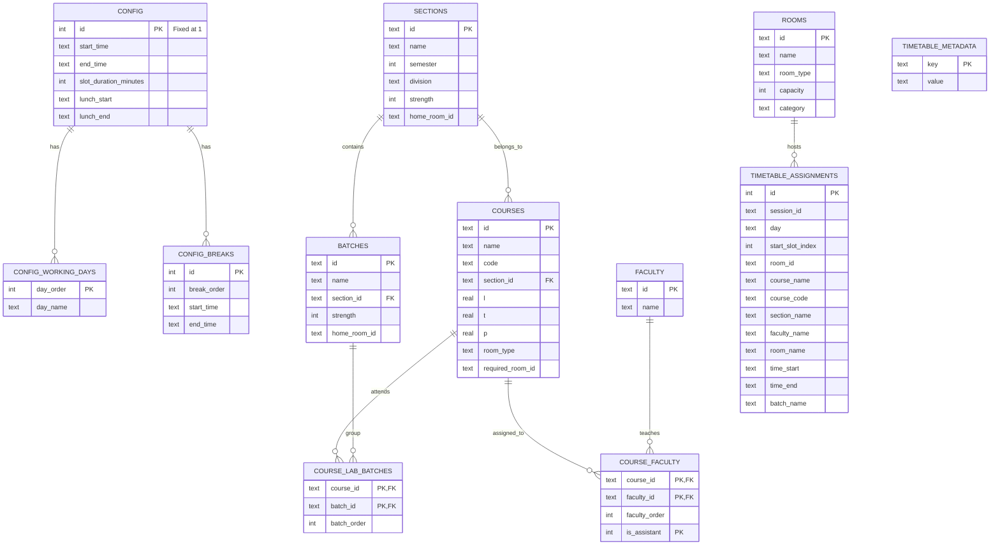

# Database Architecture — CampusGrid
## SQLite Relational Schema, Foreign Keys, and Persistence Mechanics

---

### 1. Why SQLite?

For an academic scheduling application operating at the department or college level, **SQLite** was chosen because:
1. **Serverless & Embedded**: SQLite runs inside the Python process. No need to install, configure, or administer MySQL, PostgreSQL, or Oracle database servers.
2. **Single-File Portability**: The entire database lives inside one file (`autoschedule.db`). It can be copied, backed up, or migrated simply by moving the file.
3. **ACID Compliance**: Full support for Atomic, Consistent, Isolated, and Durable transactions.
4. **Relational Integrity**: Foreign keys (`PRAGMA foreign_keys = ON`) maintain referential integrity with `ON DELETE CASCADE`.

---

### 2. Complete Database Schema (Verified against Source Code)

The database consists of **12 structured tables**:



---

### 3. Detailed Table Explanations

#### A. Institutional Configuration Tables
1. **`config`**:
   - `id`: Primary key, constrained to `CHECK (id = 1)`. Holds single-row global settings.
   - `start_time`, `end_time`: Overall college day boundaries (e.g. `'09:00'`, `'17:00'`).
   - `slot_duration_minutes`: Duration of each standard period (e.g. `60`).
   - `lunch_start`, `lunch_end`: College lunch break interval.
2. **`config_working_days`**:
   - `day_order` (PK): Order index (0, 1, 2, ...).
   - `day_name`: Day of the week (`'Monday'`, `'Tuesday'`, etc.).
3. **`config_breaks`**:
   - Stores custom short tea or recess breaks with `break_order`, `start_time`, and `end_time`.

#### B. Academic Resource Tables
4. **`rooms`**:
   - `id` (PK): Unique identifier (e.g. `'R101'`, `'LAB_CS_1'`).
   - `name`: Display name.
   - `room_type`: Must be `'THEORY_ROOM'` or `'LAB'`.
   - `capacity`: Maximum number of students that can sit here.
   - `category`: Department or building code (e.g. `'CS'`, `'EC'`).
5. **`faculty`**:
   - `id` (PK): Unique teacher identifier (e.g. `'F1'`, `'F_SHARMA'`).
   - `name`: Full name (e.g. `'Dr. Sharma'`).
6. **`sections`**:
   - `id` (PK): E.g. `'3A'`, `'5B'`.
   - `name`: Section title.
   - `semester`: Academic term integer (e.g. `3`, `5`).
   - `division`: Letter division (`'A'`, `'B'`).
   - `strength`: Class student headcount.
   - `home_room_id`: Optional default designated classroom.
7. **`batches`**:
   - `id` (PK): E.g. `'3A_B1'`, `'3A_B2'`.
   - `section_id` (FK): References `sections(id)` with `ON DELETE CASCADE`. If a section is removed, all its sub-batches are cleaned up automatically.
   - `strength`: Number of students in this practical lab batch.

#### C. Syllabus & Association Tables
8. **`courses`**:
   - `id` (PK): Unique course code/id (e.g. `'CS301_3A'`).
   - `name`, `code`: Subject name and university course code.
   - `section_id` (FK): References `sections(id)`.
   - `l`, `t`, `p`: Weekly Lecture, Tutorial, Practical credit hours.
   - `room_type`: Required facility type (`'THEORY_ROOM'` or `'LAB'`).
   - `required_room_id`: Specific room requirement if any.
9. **`course_faculty`**:
   - Composite PK: `(course_id, faculty_id, is_assistant)`.
   - Supports team-teaching and lab assistants: `is_assistant = 0` for lead professors, `is_assistant = 1` for lab assistants.
10. **`course_lab_batches`**:
   - Composite PK: `(course_id, batch_id)`.
   - Maps which practical batches attend this lab course.

#### D. Timetable Results & Metadata Tables
11. **`timetable_assignments`**:
   - Contains denormalized, ready-to-display schedule rows.
   - `session_id`, `day`, `start_slot_index`, `room_id`.
   - Pre-computed display fields: `course_name`, `course_code`, `section_name`, `faculty_name`, `room_name`, `time_start`, `time_end`, `batch_name`.
   - *Why denormalized?* When rendering views for the Academic Administrator or exporting to PDF/Excel, the system can fetch everything in one simple `SELECT * FROM timetable_assignments` without complex 8-table joins!
12. **`timetable_metadata`**:
   - Key-value table storing generator run results: `status` (`'success'` or `'infeasible'`), generated timestamps, and diagnostic messages.

---

### 4. How Persistence Works in Code (`database.py`)

#### Reading Data (`load_data`):
```python
def load_data(app_data: Dict[str, Any], db_path: Optional[str] = None) -> None:
    init_db(db_path)
    with _lock:
        conn = get_connection(db_path)
        try:
            cur = conn.cursor()
            # 1. Fetch config, working days, and breaks
            # 2. Fetch rooms into Room dataclass instances
            # 3. Fetch faculty into Faculty dataclass instances
            # 4. Fetch sections and batches
            # 5. Fetch courses and associate faculty and lab batches
            # 6. Fetch existing timetable assignments if any
        finally:
            conn.close()
```

#### Writing Data (`save_data`):
`save_data()` uses a transactional wipe-and-reload pattern:
1. Opens connection and enters `with conn:` (atomic database transaction).
2. Clears existing table contents.
3. Inserts all active domain objects and newly generated assignments.
4. If an exception occurs, the transaction automatically rolls back, preserving previous database state!
5. Thread-safe execution is guaranteed via Python's `threading.RLock()`.
