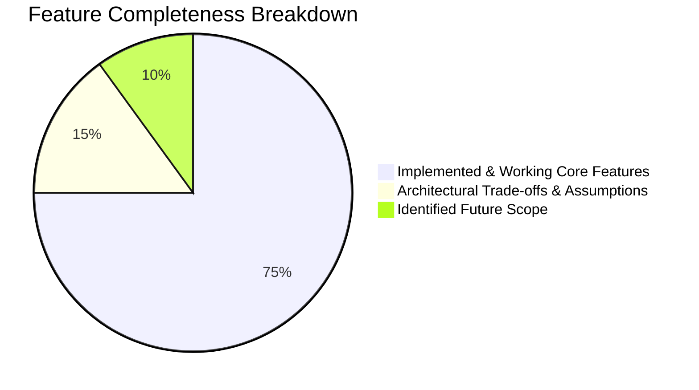

# Project Limitations, Edge Cases & Future Scope — CampusGrid
## Honest Architectural Appraisal and Engineering Trade-offs

---

### 1. Honest Appraisal: What the System Does vs. Doesn't Do

A senior engineering project should be completely honest about its boundaries. A review committee respects engineering rigor far more when they acknowledge architectural trade-offs rather than pretending their software is flawless.

---

### 2. Verified Technical Limitations

#### A. Static Weekly Template vs. Calendar-Dated Timetable
- **Current Behavior**: The system creates an abstract recurring 5-day or 6-day weekly timetable (Monday through Friday).
- **Limitation**: It does not link to specific calendar dates (e.g., September 15th to December 20th), national holidays, exam weeks, or semester break schedules.

#### B. Single-Building Proximity Assumption
- **Current Behavior**: The solver checks if a room is free and suitable.
- **Limitation**: It assumes all classrooms and labs are in the same physical building. If a professor has a lecture on the 4th floor of Building A at 10:00 AM and another lecture in Building C at 11:00 AM, the system treats them as consecutive without calculating walking transit time.

#### C. Single-Admin Security Model (No Role-Based Access Control)
- **Current Behavior**: Any user who navigates to `http://127.0.0.1:5001` has full administrative power to edit rooms, delete faculty, or wipe the database.
- **Limitation**: There is no login authentication system, session tokens, or Role-Based Access Control (RBAC) separating Academic Administrator, Faculty, and Student privileges.

#### D. Global Regeneration vs. Ad-Hoc Dynamic Substitution
- **Current Behavior**: If a faculty member calls in sick on Wednesday morning, the system does not have an "emergency single-period substitution" button.
- **Limitation**: To adjust a schedule, the administrator must modify faculty assignments or availability and re-run the solver for the entire department.

#### E. Strict Single-Slot Theory Assumption
- **Current Behavior**: In `_create_sessions()`, theory hours ($L + T$) are always partitioned into 1.0-hour discrete sessions.
- **Limitation**: If a department has block 2-hour or 1.5-hour theory lectures (e.g., in postgraduate or specialized seminar courses), the system currently only groups multi-hour blocks for practical labs (`CourseType.LAB`).

---

### 3. Edge Cases & Potential Corner Cases

| Edge Case | How the Current Code Behaves | Ideal Engineering Solution |
| :--- | :--- | :--- |
| **Lab Batch without enough lab rooms** | If 4 lab batches exist, but only 1 computer lab exists in the college, parallel scheduling is impossible. The solver backtracks up to 50,000 times, times out, and reports `infeasible`. | Add a pre-check in `_create_sessions()` comparing simultaneous lab batch requirements against total available lab rooms. |
| **Slot Duration not cleanly dividing day hours** | If working hours are 09:00 to 17:30 (510 minutes) and slot duration is 60 minutes, the final 30-minute block is truncated. | Enforce that `(end_time - start_time)` must be an exact multiple of `slot_duration_minutes` during config validation. |
| **Faculty with zero assigned courses** | If a faculty member is entered in the database but assigned to zero courses, they appear in the faculty directory but have an empty schedule grid. | Handled gracefully: the system simply renders an empty weekly grid with no crashes. |
| **Course assigned to a deleted Faculty or Room** | SQLite enforces foreign keys (`PRAGMA foreign_keys = ON;`). Deleting a section cascades to courses and batches. Deleting a room or faculty that is referenced will be blocked or require re-assignment. | Fully handled by SQLite foreign key constraints and validation. |

---

### 4. Performance Bottlenecks & Algorithmic Scalability

1. **The Lab Room Bottleneck**:
   Theory lectures are flexible because any `THEORY_ROOM` can host any standard lecture. Practical labs, however, are strictly bound to `LAB` rooms and require 2 consecutive slots. In high-density departments, 90% of backtracking time is spent trying to fit multi-hour lab blocks around shared labs and common lunch breaks.

2. **Scaling to College-Wide Scheduling**:
   - For a single department (4–6 sections, 20–30 faculty): Solves in **30–100 milliseconds**.
   - For an entire university campus (50 sections, 200 faculty, 60 rooms): Backtracking tree depth increases exponentially. A departmental solver would need to be sharded or run in parallel per department with shared campus auditorium/lab reservation locks.

---

### 5. Realistic Future Improvements

If our team continues developing this project for our final year capstone, here is our roadmap:

1. **Role-Based Access Control (RBAC)**:
   - **Academic Administrator / Admin**: Full edit and generator rights.
   - **Faculty**: Read-only personal timetable view with leave request submission.
   - **Students**: Read-only section view and exam schedule download.

2. **Emergency Leave & Daily Substitution Engine**:
   A quick module where an administrator marks "Prof. Sharma on leave today (Wednesday)", and the system recommends an available free teacher who teaches the same or related subject without touching the rest of the week's timetable.

3. **PDF / Calendar Synchronization Export**:
   - Direct export to standard iCalendar (`.ics`) format so teachers and students can sync their timetables with Google Calendar or Apple Calendar on their smartphones.
   - Branded PDF generation using ReportLab with official college letterheads and signature lines.

4. **Multi-Campus Travel Time Constraints**:
   Adding a distance matrix between campus blocks (e.g. Mechanical Block to Computer Science Block) and penalizing consecutive classes in different blocks.
